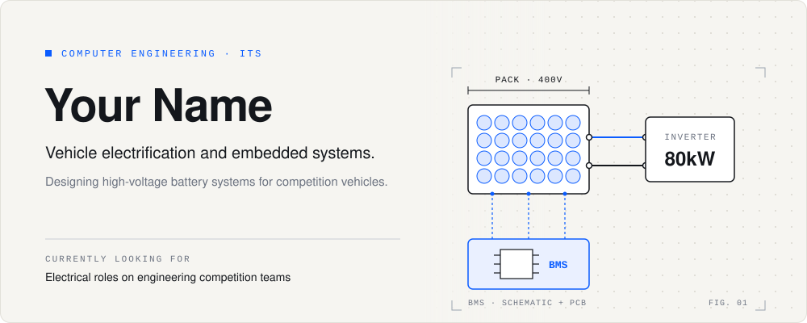

[LinkedIn](https://www.linkedin.com/in/[your-linkedin]) · [Email](mailto:[your-email])

## About

I'm a computer engineering student at Institut Teknologi Sepuluh Nopember (ITS), working on vehicle electrification and embedded systems. I also work as a full-stack developer at Edental, where I've spent more than three years building PHP backends and web applications.

I'm aiming for a career in automotive or aviation electrical engineering, and I'm looking to join competition teams, such as Shell Eco-marathon and local energy-efficient car events, on the electrical side.

## Projects

Both projects come from my internship in the High Voltage division of Anargya ITS (Formula SAE).

### High-voltage battery pack

`400V` `80kW inverter`

Designed the pack from vehicle performance data and sized it to match the inverter.

### Battery management system

`Schematic` `PCB`

Designed the schematic and PCB for the pack's battery management system.

<!--
To add once confirmed: cell configuration, pack capacity, BMS measurements,
PCB tool, project status. Link the repos only after the team approves.
-->

## Skills

- Electrical and embedded: high-voltage pack design, BMS design, schematic and PCB design, sensor integration, control systems, ROS
- Software: PHP (Laravel, CodeIgniter 4), JavaScript, Node.js, React, MySQL
