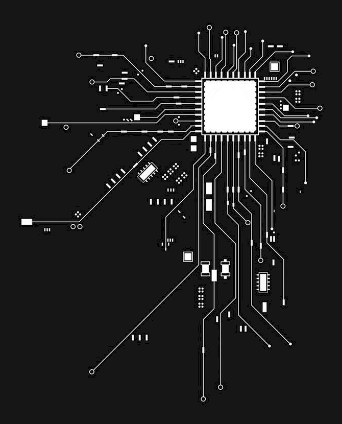

[About](#about) · [Experience and skills](#experience-and-skills) · [Projects](#projects) · [LinkedIn](https://www.linkedin.com/in/[your-linkedin]) · [Email](mailto:[your-email])

## About

I'm a computer engineering student at Institut Teknologi Sepuluh Nopember (ITS), working on vehicle electrification and embedded systems, and a full-stack developer with 3+ years of experience.

I'm aiming for a career in automotive or aviation electrical engineering, and I'm looking to join competition teams, such as Shell Eco-marathon and local energy-efficient car events, on the electrical side.

## Experience and skills

<table>
<tr>
<td width="64%" valign="top">

### Experience

**Electrical Engineer Intern**, High Voltage division
Anargya ITS (Formula SAE)
Designed a 400V battery pack from vehicle performance data and sized it for an 80kW inverter. Designed the schematic and PCB for its battery management system.

**Full-stack Developer**, Edental
Current role. Building PHP backends and web applications with Laravel, CodeIgniter 4, and MySQL.

**Computer Engineering**, Institut Teknologi Sepuluh Nopember (ITS)
Undergraduate, second year.

### Skills

**Engineering software**
`KiCad` `Proteus` `SolidWorks` `Fusion Electrical` `Fusion 360`

**Programming**
`PHP` `JavaScript` `Node.js` `React` `Laravel` `CodeIgniter 4` `MySQL`

**Electrical and embedded**
High-voltage pack design, BMS design, schematic and PCB design, sensor integration, control system fundamentals, ROS

</td>
<td width="36%" valign="top">

</td>
</tr>
</table>

<!--
Add dates to each experience entry once confirmed.
-->

## Projects

Both projects come from my internship in the High Voltage division of Anargya ITS (Formula SAE).

### High-voltage battery pack

`400V` `80kW inverter`

Designed the pack from vehicle performance data and sized it to match the inverter.

### Battery management system

`Schematic` `PCB`

Designed the schematic and PCB for the pack's battery management system.

<!--
To add once confirmed: cell configuration, pack capacity, BMS measurements,
project status. Link the repos only after the team approves.
-->
