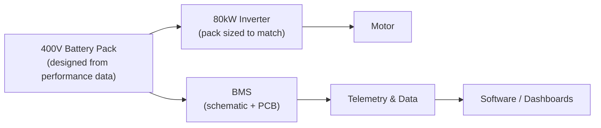

# ⚡ Hi, I'm [Your Name]

**Computer Engineering @ ITS · Vehicle Electrification & Embedded Systems**

High-voltage battery packs · BMS design · ROS · Full-stack development

---

## 🔋 What I build

From the battery pack to the software that reads it:

| Focus | What I do |
|---|---|
| **High-voltage systems** | Pack design and sizing against vehicle performance data and inverter limits |
| **Battery management** | BMS schematic and PCB design |
| **Embedded & robotics** | Sensor integration, control systems fundamentals, ROS |
| **Software** | 3+ years building data-driven backends and web apps |

---

## 🚀 Featured projects

| Project | What it is | Highlights |
|---|---|---|
| **[HV Battery Pack Design](link-to-repo)** | 400V pack designed for an 80kW inverter | [cell config] · [capacity] · [status: design / simulated / built] |
| **[BMS Hardware](link-to-repo)** | Schematic and PCB for a battery management system | [what it measures] · [tool used] · [communication] |
| **[ROS / Sensor Project](link-to-repo)** | [one-line description] | [sensors used] · [demo link] |
| **[Firmware Project](link-to-repo)** | [one-line description] | [microcontroller] · [what it does] |

---

## 🧰 Toolbox

**Electrical & embedded:** High-voltage pack design · BMS design · Schematic & PCB design · Sensor integration · Control systems · ROS

**Software:**

---

## 📍 Right now

- 💼 Full-stack developer at Edental
- 🎓 Computer Engineering student at Institut Teknologi Sepuluh Nopember (ITS)
- 🏎️ Previously in the High Voltage division at Anargya ITS (Formula SAE)
- 🎯 Looking to join competition engineering teams (Shell Eco-marathon, energy-efficient car events) on the electrical side

*Aiming for automotive and aviation electrical engineering.*

