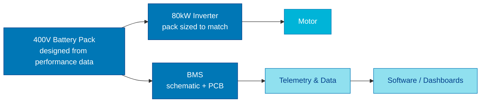

<!-- Header banner -->

<!-- Rotating tagline -->

 

 

## ⚡ About me

Computer Engineering student at **Institut Teknologi Sepuluh Nopember (ITS)** focused on vehicle electrification and embedded systems, with 3+ years of experience as a full-stack developer. I like the point where software meets physical systems, and I'm aiming for a career in **automotive and aviation electrical engineering**.

 

## 🔋 What I build

| 🔌 High-voltage systems | 🧠 Battery management | 🤖 Embedded & robotics | 💻 Software |
|:---:|:---:|:---:|:---:|
| Pack design and sizing against performance data and inverter limits | BMS schematic and PCB design | Sensor integration, control systems, ROS | 3+ years of backend and web development |

 

## 🚀 Featured projects

| Project | Description | Highlights |
|:---|:---|:---|
| **[HV Battery Pack Design](link-to-repo)** | 400V pack for an 80kW inverter | [cell config] · [capacity] · [design / simulated / built] |
| **[BMS Hardware](link-to-repo)** | Schematic and PCB for a battery management system | [what it measures] · [tool used] · [communication] |
| **[ROS / Sensor Project](link-to-repo)** | [one-line description] | [sensors] · [demo link] |
| **[Firmware Project](link-to-repo)** | [one-line description] | [microcontroller] · [what it does] |

 

## 🧰 Toolbox

**Electrical & embedded:** High-voltage pack design · BMS design · Schematic & PCB design · Sensor integration · Control systems

  

 

## 📍 Right now

> 💼 Full-stack developer at **Edental**
> 🎓 Computer Engineering at **ITS**
> 🏎️ Previously in the High Voltage division at **Anargya ITS** (Formula SAE)
> 🎯 Looking to join competition engineering teams (Shell Eco-marathon, energy-efficient car events) on the electrical side

<!-- Footer banner -->

