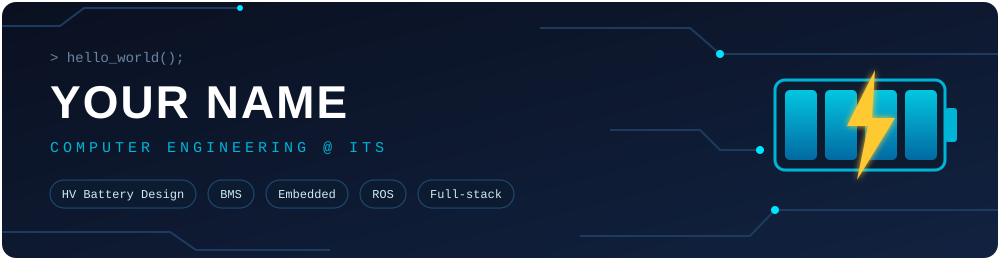
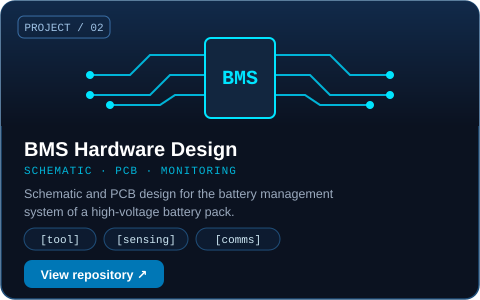

 

---

## ⚡ About me

I'm **[Your Name]**, a Computer Engineering student at **Institut Teknologi Sepuluh Nopember (ITS)** focused on vehicle electrification and embedded systems.

I like working where software meets physical systems. Through the High Voltage division of a Formula SAE team, I designed a **400V battery pack** from vehicle performance data, sized it for an **80kW inverter**, and designed the **schematic and PCB of its battery management system**. Alongside that, I've worked for 3+ years as a full-stack developer.

I'm aiming for a career in **automotive and aviation electrical engineering**.

---

## 🛠️ Tech stack

### Electrical & embedded
     

### Software

`PHP` · `Laravel` · `CodeIgniter 4` · `JavaScript` · `Node.js` · `React` · `MySQL`

### Tools

`[PCB tool, e.g. KiCad / Altium]` · `[simulation tool]` · `Git` · `GitHub`

---

## 📂 Featured projects

<table>
  <tr>
    <td width="50%"></td>
    <td width="50%"></td>
  </tr>
</table>

<b>⚡ HV Battery Pack Design: features & technical highlights</b>

- [Cell type and configuration, e.g. XsYp]
- [Pack capacity and voltage range]
- [How the pack was matched to the 80kW inverter: current limits, etc.]
- [Safety considerations: fusing, isolation, precharge, if applicable]
- Status: [design only / simulated / prototyped / tested]

<b>🧠 BMS Hardware Design: features & technical highlights</b>

- [What it measures: cell voltage, temperature, current]
- [Balancing method, if any]
- [Communication, e.g. CAN]
- [Tool used for schematic and PCB]
- Status: [design only / fabricated / tested]

Design documentation only. Some files are withheld out of respect for team and sponsor confidentiality.

---

## 📍 Right now

- 💼 Full-stack developer at **Edental**
- 🎓 Computer Engineering at **ITS**
- 🏎️ Previously in the High Voltage division at **Anargya ITS** (Formula SAE)
- 🎯 Looking to join competition engineering teams (Shell Eco-marathon, energy-efficient car events) on the electrical side

