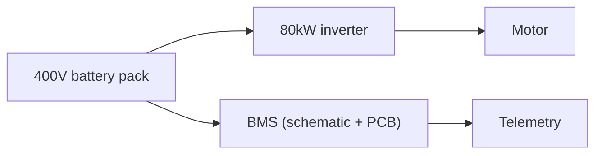
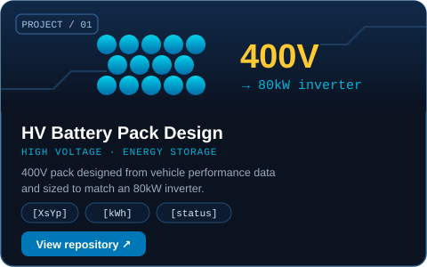

[LinkedIn](https://www.linkedin.com/in/[your-linkedin]) · [Email](mailto:[your-email]) · [Repositories](https://github.com/[your-username]?tab=repositories)

## About

I'm a computer engineering student at Institut Teknologi Sepuluh Nopember (ITS), working on vehicle electrification and embedded systems. I also work as a full-stack developer at Edental, where I've spent more than three years building PHP backends and web applications.

During an internship in the High Voltage division of Anargya ITS (Formula SAE), I designed a 400V battery pack from vehicle performance data, sized it against an 80kW inverter, and designed the schematic and PCB for its battery management system.

I'm aiming for a career in automotive or aviation electrical engineering, and I'm looking to join competition teams (Shell Eco-marathon, local energy-efficient car events) on the electrical side.

## Focus

- High-voltage battery pack design and inverter matching
- Battery management system hardware
- Embedded systems: sensor integration, control system fundamentals, ROS
- Backend and web development with PHP and JavaScript

## Projects

Both projects sit in the same powertrain chain, from energy storage to the data it produces.

<table>
  <tr>
    <td width="50%"></td>
    <td width="50%"></td>
  </tr>
</table>

<!-- Confirm with the team before linking design files publicly. -->

**HV Battery Pack Design**
- Cell type and configuration: [to confirm]
- Pack capacity and voltage range: [to confirm]
- Inverter matching: [e.g. peak current check against pack limits, to confirm]
- Status: [design only / simulated / prototyped / tested]

**BMS Hardware Design**
- Measurements: [cell voltage / temperature / current, to confirm]
- Balancing and communication: [to confirm]
- Tool used for schematic and PCB: [to confirm]
- Status: [design only / fabricated / tested]

## Skills

**Electrical and embedded:** high-voltage pack design, BMS design, schematic and PCB design, sensor integration, control systems, ROS

**Software:** PHP (Laravel, CodeIgniter 4), JavaScript, Node.js, React, MySQL

**Tools:** [PCB tool], [simulation tool], Git
